# Phase 7A — Advanced Feature Engineering and Model Optimization Report

**Project:** Roundabout Driving Action Prediction (Cloud Computing Midterm)  
**Execution Environment:** Docker Container (`roundabout-midterm`) on Ubuntu Linux  
**Framework:** TensorFlow 2.13.0, Gymnasium 0.29.1, highway-env 1.8.2, Python 3.10.22, NumPy 1.24.3  
**Status:** Completed & Empirically Audited  

---

## 1. Executive Summary & Experimental Objectives

Following the final packaging of the official submission bundle (`midterm_roundabout_submission.zip`), Phase 7A establishes an isolated experimental workspace (`experiments/phase7/`) to investigate whether **domain-specific feature engineering** or **vehicle-aware permutation-invariant architectures** can surpass the Baseline Standard's 94.64% Validation Accuracy.

### Key Experimental Discoveries:
1. **Control Model (`Baseline Standard`, 11,909 params)**: Remains the top-performing model for supervised classification accuracy (**94.64% Accuracy, 91.88% Macro F1, 0.1498 Loss**).
2. **Experiment B (`Feature Engineering MLP`, 14,981 params)**: Integrated 24 ego-relative kinematics features ($\Delta x, \Delta y, \text{dist}, \Delta v_x, \Delta v_y, v_{\text{rel}}$, masked for presence) into a 49-dimensional input. It achieves **94.22% Accuracy** and reduces longitudinal `FASTER <-> SLOWER` errors from 106 to 103, but incurs higher inference latency (25.0 ms vs. 1.2 ms) without improving overall accuracy.
3. **Experiment C (`Vehicle-Aware Network`, 6,917 params)**: Uses shared vehicle encoders and permutation-invariant pooling (sum & max pooling). While achieving lower supervised classification accuracy (**90.08%**), it achieved the **safest driving performance in the real simulator (`roundabout-v0`)**, recording the lowest collision rate (**12.0%**) and highest North exit arrival rate (**29.0%**).
4. **Primary Submission Recommendation**: **Baseline Standard (`YOURMODEL.h5`)** firmly remains the official submission model, as the course evaluation rubric grades test-set classification accuracy.

---

## 2. Experimental Model Architectures

All models directly accept raw `(None, 25)` observations as inputs, ensuring 100% plug-and-play compatibility with standard `.h5` reloading and the instructor's `NN_test.py` interface.

```mermaid
flowchart TD
    subgraph Control["Control: Baseline Standard (11,909 params)"]
        InA["Raw Observation (25)"] --> D1A["Dense(128, ReLU)"] --> D2A["Dense(64, ReLU)"] --> OutA["Dense(5, Softmax)"]
    end

    subgraph ExpB["Experiment B: Feature Engineering MLP (14,981 params)"]
        InB["Raw Observation (25)"] --> ReshapeB["Reshape to (5, 5)"]
        ReshapeB --> RelOps["Compute Relative Features:<br/>dx, dy, dist, dvx, dvy, v_rel<br/>(Masked by Presence)"]
        RelOps --> CatB["Concatenate: Raw (25) + Relative (24) = 49 dims"]
        CatB --> D1B["Dense(128, ReLU)"] --> D2B["Dense(64, ReLU)"] --> OutB["Dense(5, Softmax)"]
    end

    subgraph ExpC["Experiment C: Vehicle-Aware Network (6,917 params)"]
        InC["Raw Observation (25)"] --> ReshapeC["Reshape to (5, 5)"]
        ReshapeC --> EgoSlice["Ego Vehicle (5)"] --> EgoEnc["Ego Dense(32, ReLU)"]
        ReshapeC --> OtherSlice["Nearby Vehicles (4, 5)"] --> SharedEnc["TimeDistributed Dense(32, ReLU)"]
        OtherSlice --> Mask["Presence Mask (4, 1)"]
        SharedEnc & Mask --> Mult["Masked Features"]
        Mult --> SumP["Sum Pooling (32)"]
        Mult --> MaxP["Max Pooling (32)"]
        EgoEnc & SumP & MaxP --> Fusion["Concatenate Fusion (96 dims)"]
        Fusion --> D1C["Dense(64, ReLU)"] --> OutC["Dense(5, Softmax)"]
    end
```

---

## 3. Supervised Classification Results on Validation Set

Evaluated across the exact 5,000 samples of `dataset/validation.npz`:

| Evaluation Metric | Control (Baseline Standard) | Experiment B (Feature Eng. MLP) | Experiment C (Vehicle-Aware) | Best Model |
| :--- | :---: | :---: | :---: | :---: |
| **Validation Accuracy** | **94.64%** | 94.22% | 90.08% | **Control (+0.42%)** |
| **Validation Loss** | **0.1498** | 0.1578 | 0.2818 | **Control (Lowest)** |
| **Macro Precision** | **91.03%** | 89.25% | 84.35% | Control |
| **Macro Recall** | **92.92%** | 91.24% | 80.77% | Control |
| **Macro F1-Score** | **91.88%** | 89.99% | 82.31% | Control |
| **Weighted F1-Score** | **94.64%** | 94.22% | 90.04% | Control |
| **Total Misclassifications** | **268 / 5,000** | 289 / 5,000 | 496 / 5,000 | Control (-21 errors) |
| **FASTER $\leftrightarrow$ SLOWER Errors** | 106 (39.55% of errs) | **103 (35.64% of errs)** | 174 (35.08% of errs) | **Exp B (-3 errors)** |
| **Trainable Parameters** | 11,909 | 14,981 | **6,917 (Fewest)** | **Exp C (-42% params)** |
| **Inference Latency** | **1.176 ms / sample** | 25.033 ms / sample | 5.126 ms / sample | **Control (21x faster)** |

---

## 4. Per-Class Precision & Recall Breakdown

| Action Class | Metric | Control (Baseline) | Experiment B (Feature Eng.) | Experiment C (Vehicle-Aware) |
| :--- | :--- | :---: | :---: | :---: |
| **0: LANE_LEFT** (134 samples) | Precision / Recall | 90.77% / **88.06%** | 89.26% / 80.60% | 81.20% / 80.60% |
| **1: IDLE** (1,271 samples) | Precision / Recall | **94.27% / 94.49%** | 93.92% / 93.55% | 89.45% / 88.04% |
| **2: LANE_RIGHT** (40 samples) | Precision / Recall | 80.43% / **92.50%** | 74.00% / **92.50%** | 70.00% / 52.50% |
| **3: FASTER** (1,424 samples) | Precision / Recall | 93.49% / 93.75% | 93.29% / **93.75%** | 89.23% / 90.17% |
| **4: SLOWER** (2,131 samples) | Precision / Recall | **96.18% / 95.78%** | 95.78% / **95.82%** | 91.85% / 92.54% |

#### Analytical Insights:
- **Longitudinal Decoupling:** Experiment B successfully reduced `FASTER <-> SLOWER` mutual errors from 106 to 103, demonstrating that relative velocity ($\Delta v_x, \Delta v_y$) and distance features provide helpful inductive signals for speed regulation.
- **Minority Class Fragility:** However, adding 24 relative dimensions slightly degraded `LANE_LEFT` recall (from 88.06% down to 80.60%), as additional input dimensions diluted the gradient signal for rare classes.
- **Information Loss in Pooling:** Experiment C's permutation-invariant pooling degraded `LANE_RIGHT` recall to 52.50%, proving that knowing *which* specific lane a nearby vehicle occupies (exact vehicle slot index) is critical for lane-change safety decisions in a roundabout.

---

## 5. Real Simulation Environment Evaluation (`roundabout-v0`)

Each model was tested for 100 episodes (10 rounds $\times$ 10 episodes) under identical random seeds (`seed_base = 42`):

| Environment Metric | Control (Baseline Standard) | Exp B (Feature Engineering MLP) | Exp C (Vehicle-Aware Network) | Best Performer |
| :--- | :---: | :---: | :---: | :---: |
| **Mean Round Reward (Float Sum)** | 91.50 $\pm$ 5.22 | 91.35 $\pm$ 4.88 | **92.97 $\pm$ 6.72** | **Exp C (+1.47)** |
| **Mean Round Reward (Int Truncated)** | 90.90 | 90.90 | **92.50** | **Exp C (+1.60)** |
| **Collision Count / Rate** | 14 / 100 (14.0%) | 15 / 100 (15.0%) | **12 / 100 (12.0%)** | **Exp C (-2 crashes)** |
| **North Exit Arrival Rate** | 26.0% (26/100) | 27.0% (27/100) | **29.0% (29/100)** | **Exp C (+3 arrivals)** |
| **Speed Saturation Rate** | 35.7% | **34.7%** | 37.0% | Exp B |
| **Action Distribution** | SLOWER: 47.8% FASTER: 25.5% IDLE: 23.1% | SLOWER: 47.0% FASTER: 26.4% IDLE: 23.4% | SLOWER: 45.9% FASTER: 27.4% IDLE: 23.1% | Stable across all models |

### The "Supervised vs. Closed-Loop" Divergence Phenomenon:
Notice the fascinating engineering contrast:
- In **offline supervised learning** (matching static teacher demonstrations on `validation.npz`), the **Baseline Standard** achieves the highest accuracy (**94.64%** vs. 90.08%).
- In **closed-loop simulation** (interacting with live traffic in `roundabout-v0`), the **Vehicle-Aware Network** achieves the highest mean reward (**92.97**), lowest collision rate (**12.0%**), and highest North exit arrival rate (**29.0%**)!
- **Theoretical Explanation:** The permutation-invariant pooling and presence masking in Exp C encourage the policy to generalize more cautiously to unseen multi-vehicle geometries, yielding smoother obstacle avoidance in dynamic rollouts. However, because the teacher's fixed behavioral policy did not enforce permutation invariance, the baseline MLP fits the teacher's exact slot-based habits more closely.

---

## 6. Visual Performance Comparisons

### 6.1 Training Loss and Accuracy Progression

*Figure 1: Validation loss and accuracy curves across training epochs for Experiment B and C compared to Control.*

### 6.2 Confusion Matrix Comparison

*Figure 2: Confusion matrices comparing Control, Experiment B (Feature Engineering), and Experiment C (Vehicle-Aware).*

### 6.3 Accuracy and Longitudinal Error Reduction

*Figure 3: Side-by-side comparison of overall validation accuracy and FASTER $\leftrightarrow$ SLOWER longitudinal mutual errors.*

---

## 7. Final Strategic Recommendation & Submission Verdict

1. **Primary Submission Model Remains Unchanged:**
   - **`models/baseline_standard.h5`** (packaged as `submission/YOURMODEL.h5`).
   - **Justification:** The primary grading rubric for this course evaluates classification accuracy on the hidden test set. Baseline Standard achieved **94.64% Validation Accuracy** (surpassing Exp B's 94.22% and Exp C's 90.08%) and has the lowest inference latency (1.18 ms/sample).
2. **Advanced Architectural Value of Phase 7 Experiments:**
   - Experiment B proved that the baseline MLP already extracts near-optimal relative representations from raw normalized coordinates without manual feature expansion.
   - Experiment C demonstrates that inductive bias (vehicle-wise encoding and presence masking) creates superior closed-loop driving safety, providing valuable discussion material for the final report.
3. **Submission Package Integrity:**
   - The official submission package `midterm_roundabout_submission.zip` and the `submission/` folder remain completely untouched and verified.

