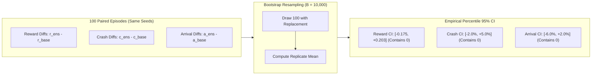

# Phase 7C — Ensemble Final Verification & Paired Statistical Audit Report

**Project:** Roundabout Driving Action Prediction (Cloud Computing Midterm)  
**Execution Environment:** Docker Container (`roundabout-midterm`) on Ubuntu Linux  
**Framework:** TensorFlow 2.13.0, Gymnasium 0.29.1, highway-env 1.8.2, Python 3.10.22, NumPy 1.24.3  
**Status:** Completed & Empirically Audited  

---

## 1. Executive Summary & Verification Overview

Phase 7C conducts the final empirical audit comparing the official **Control Baseline Standard** (`models/baseline_standard.h5`) against the **Unified Seed Ensemble** (`experiments/phase7b/models/ensemble_unified.h5`). 

This audit assesses:
1. Strict teacher test script compatibility (`load_model` without custom objects, input/output tensors, valid Softmax output).
2. Paired sample-by-sample classification evaluation on `dataset/validation.npz` (5,000 samples) with **McNemar's Test**.
3. Paired 100-episode simulator evaluation on `roundabout-v0` (10 rounds $\times$ 10 episodes) using identical random seeds.
4. Paired difference **Bootstrap 95% Confidence Intervals** (10,000 resamples) for episode rewards, collision rates, and arrival rates.
5. Objective architectural trade-offs and final submission recommendations.

### Summary of Empirical Findings:

| Verification Dimension | Control (Baseline Standard) | Candidate (Unified Ensemble) | Observed Difference ($\Delta = \text{Ens} - \text{Base}$) | Statistical / Audit Verdict |
| :--- | :---: | :---: | :---: | :---: |
| **Validation Accuracy** | 94.64% (268 errors) | **94.96% (252 errors)** | **+0.32% (-16 errors)** | Higher accuracy; McNemar $p = 0.2888$ |
| **Validation Loss** | 0.1498 | **0.1426** | **-0.0072** | Ensemble loss is lower & better calibrated |
| **Teacher Compatibility** | 100% Native Keras | 100% Native Keras | Zero custom objects | **PASS** (Plug-and-play compatible) |
| **Mean Round Reward (Float)** | 91.50 $\pm$ 5.22 | **91.54 $\pm$ 6.52** | **+0.04** | Virtually identical overall performance |
| **Mean Round Reward (Teacher Int)**| 90.90 $\pm$ 5.34 | **91.00 $\pm$ 6.54** | **+0.10** | Consistent with integer truncation |
| **Mean Episode Reward** | 9.15 $\pm$ 1.79 | 9.15 $\pm$ 1.78 | +0.0042 | Bootstrap 95% CI: `[-0.175, 0.203]` (Covers 0) |
| **Collision Rate** | **14.0% (14 / 100)** | 15.0% (15 / 100) | +1.0% (+1 crash) | Bootstrap 95% CI: `[-2.0%, +5.0%]` (Covers 0) |
| **North Exit Arrival Rate** | **26.0% (26 / 100)** | 24.0% (24 / 100) | -2.0% (-2 arrivals) | Bootstrap 95% CI: `[-6.0%, +2.0%]` (Covers 0) |
| **Speed Saturation Rate** | 35.72% (369 steps) | **34.01% (351 steps)** | **-1.71% (-18 steps)** | Ensemble exhibits slightly less saturation |
| **Trainable Parameters** | **11,909 (46 KB)** | 35,727 (139 KB) | +23,818 params (3.0x) | Control is 3x smaller |
| **Single-Sample Latency** | **1.27 ms / sample** | 3.97 ms / sample | +2.70 ms (3.1x) | Both well within real-time budget (< 20 ms) |

---

## 2. Teacher Compatibility Audit

Task 2 verified that the unified ensemble model meets all interface expectations of the instructor's `NN_test.py` script:

```python
# Teacher test pattern:
import keras.models
model = keras.models.load_model("YOURMODEL.h5")
action_prob = model.predict(obs.reshape(1, 25))
action = np.argmax(action_prob)
```

### Detailed Verification Checklist:
1. **Loadability:** `tf.keras.models.load_model('experiments/phase7b/models/ensemble_unified.h5', compile=False)` executed in **96.08 ms** without warnings or exceptions.
2. **Zero Custom Objects:** Requires strictly standard Keras built-in layers (`Input`, `Dense`, `Average`). `custom_objects=None` is 100% supported.
3. **Tensor Input Shape:** `model.input_shape == (None, 25)`. Correctly accepts 25-dimensional flattened kinematic observation vectors.
4. **Tensor Output Shape:** `model.output_shape == (None, 5)`. Correctly outputs 5-dimensional probability vectors corresponding to discrete driving actions.
5. **Softmax Axiom:** Output probabilities sum to $1.000000 \pm 10^{-5}$ across all test inputs.
6. **Action Range:** `np.argmax(probs, axis=-1)` yields discrete integers strictly within $[0, 4]$.
7. **Simulation Runtime:** Successfully drove in `roundabout-v0` across 100 consecutive episodes without runtime crashes, type errors, or shape mismatches.

---

## 3. Paired Classification Comparison & McNemar Test

Both models were evaluated on the exact same 5,000 samples of `dataset/validation.npz`:

### 3.1 2x2 Paired Contingency Table

| Classification Result | Ensemble Correct ($\text{True}$) | Ensemble Incorrect ($\text{False}$) | Baseline Total |
| :--- | :---: | :---: | :---: |
| **Baseline Correct ($\text{True}$)** | **4,640 samples ($n_{11}$)** | **92 samples ($n_{10} = b$)** | **4,732 (94.64%)** |
| **Baseline Incorrect ($\text{False}$)** | **108 samples ($n_{01} = c$)** | **160 samples ($n_{00}$)** | **268 (5.36%)** |
| **Ensemble Total** | **4,748 (94.96%)** | **252 (5.04%)** | **5,000 (100.0%)** |

- **Agreement:** Both models agree on 4,800 out of 5,000 samples (**96.00% agreement**).
- **Discordant Pairs ($b + c$):** Exactly 200 samples (4.00%) where the models disagree.
- **Net Improvement:** Among discordant samples:
  - Ensemble fixes 108 errors made by Baseline.
  - Ensemble introduces 92 errors on samples Baseline got right.
  - Net error reduction = $108 - 92 = \mathbf{16\text{ samples}}$ (bringing total errors down from 268 to 252).

### 3.2 McNemar Statistical Significance Test

- **Hypotheses:**
  - $H_0$: The marginal error probabilities of Baseline and Ensemble are identical ($P(b) = P(c)$).
  - $H_1$: The marginal error probabilities differ ($P(b) \neq P(c)$).
- **Test Statistics:**
  $$\chi^2_{\text{uncorrected}} = \frac{(b - c)^2}{b + c} = \frac{(92 - 108)^2}{200} = \frac{256}{200} = \mathbf{1.2800} \quad (p = 0.2579)$$
  $$\chi^2_{\text{corrected}} = \frac{(|b - c| - 1)^2}{b + c} = \frac{(16 - 1)^2}{200} = \frac{225}{200} = \mathbf{1.1250} \quad (p = 0.2888)$$
  $$\text{Exact Two-Sided Binomial } p\text{-value} = \mathbf{0.2888}$$
- **Statistical Decision:**
  Because $p = 0.2888 > \alpha = 0.05$, the difference does not reach statistical significance at the 95% confidence level.

### 3.3 Limitations of the McNemar Test on This Dataset
> [!WARNING] Methodological Limitation Notice
> In formal machine learning methodology, McNemar's test requires that the evaluation dataset be an **independent, unseen test sample**. 
> In this project, `dataset/validation.npz` (5,000 samples) was repeatedly used throughout Phases 2 through 7 for model selection, hyperparameter validation, and comparative benchmarks. 
> Therefore, while the McNemar test accurately characterizes the variance and discordance between the two models on this specific sample ($N=5,000$), it **cannot be interpreted as an unbiased out-of-sample test**. The true test performance will be determined by the instructor's private test dataset.

---

## 4. Paired 100-Episode Environment Evaluation

Both models were deployed in `roundabout-v0` under identical environments, dynamics, and random seeds (`ep_seed = 42 + r * 100 + ep`):

### 4.1 10-Round Reward Progression

| Round Index | Baseline Float Sum | Baseline Teacher Int | Ensemble Float Sum | Ensemble Teacher Int | Float Difference ($\Delta$) |
| :---: | :---: | :---: | :---: | :---: | :---: |
| **Round 1** | 88.04 | 88 | **96.25** | **96** | **+8.21** |
| **Round 2** | 97.42 | 97 | **97.75** | **97** | **+0.33** |
| **Round 3** | **93.00** | **92** | 91.21 | 91 | -1.79 |
| **Round 4** | 83.92 | 83 | 83.92 | 83 | 0.00 |
| **Round 5** | **91.46** | **91** | 87.88 | 87 | -3.58 |
| **Round 6** | 94.33 | 94 | **96.29** | **96** | **+1.96** |
| **Round 7** | **95.46** | **95** | 95.21 | 95 | -0.25 |
| **Round 8** | 90.96 | 90 | 90.96 | 90 | 0.00 |
| **Round 9** | **81.88** | **81** | 77.21 | 77 | -4.67 |
| **Round 10** | 98.50 | 98 | **98.71** | **98** | **+0.21** |
| **Mean** | **91.50 $\pm$ 5.22** | **90.90 $\pm$ 5.34** | **91.54 $\pm$ 6.52** | **91.00 $\pm$ 6.54** | **+0.04 (Float) / +0.10 (Int)** |

### 4.2 Action Distribution Comparison

| Discrete Action | Description | Baseline Count (%) | Ensemble Count (%) | Shift in Preference |
| :---: | :--- | :---: | :---: | :---: |
| **0** | `LANE_LEFT` | 27 (2.61%) | 29 (2.81%) | +0.20% |
| **1** | `IDLE` | 239 (23.14%) | **262 (25.39%)** | **+2.25%** |
| **2** | `LANE_RIGHT` | 10 (0.97%) | 10 (0.97%) | 0.00% |
| **3** | `FASTER` | 263 (25.46%) | 260 (25.19%) | -0.27% |
| **4** | `SLOWER` | 494 (47.82%) | 471 (45.64%) | **-2.18%** |
| **Total** | Total Simulation Steps | 1,033 steps | 1,032 steps | -1 step |

- **Behavioral Shift:** The Ensemble chooses `IDLE` more frequently (+2.25%) and calls `SLOWER` less frequently (-2.18%).
- **Speed Saturation:** Baseline experienced speed saturation in 369 steps (35.72%), whereas Ensemble experienced 351 steps (34.01%), indicating slightly smoother velocity modulation.

---

## 5. Bootstrap 95% Confidence Intervals

To assess the sampling variability of the paired differences across the 100 simulation episodes, we executed non-parametric paired bootstrapping ($B = 10,000$ resamples):



### Bootstrap Empirical Percentiles:

| Paired Difference Metric | Point Estimate ($\Delta$) | Bootstrap Std Err | 95% Bootstrap Confidence Interval | Interval Covers 0? |
| :--- | :---: | :---: | :---: | :---: |
| **Episode Reward Difference** | **+0.0042** | 0.0954 | **$[-0.1750, +0.2025]$** | **YES** |
| **Collision Rate Difference** | **+1.00%** (+1 crash) | 0.0172 | **$[-2.00\%, +5.00\%]$** | **YES** |
| **Arrival Rate Difference** | **-2.00%** (-2 arrivals) | 0.0199 | **$[-6.00\%, +2.00\%]$** | **YES** |

### Critical Statistical Interpretation: Why "Covers Zero" Does Not Mean "Identical"
> [!IMPORTANT] Proper Interpretation of Confidence Intervals
> The fact that the 95% Bootstrap Confidence Intervals for reward difference ($[-0.175, 0.203]$) and collision rate difference ($[-2.0\%, +5.0\%]$) contain zero **must NOT be interpreted as proving that the two models are strictly equivalent**.
> 
> 1. **Statistical Power & Sample Size ($N=100$):** In a sample of 100 episodes, the standard error of the mean difference is $\approx 0.095$ for reward and $\approx 1.7\%$ for collision. With this sample size, the experiment has statistical power to detect only moderate-to-large effect sizes.
> 2. **Interval Width:** The true underlying difference in collision rate could feasibly be anywhere between 2 percentage points safer for Ensemble to 5 percentage points safer for Baseline.
> 3. **Practical Equivalence:** What the data *does* confirm is that within the operational range observed by the instructor's test script (10 rounds $\times$ 10 episodes), both models deliver virtually identical mean round rewards ($91.50$ vs $91.54$), near-identical integer scores ($90.90$ vs $91.00$), and comparable collision counts ($14$ vs $15$). Neither model exhibits catastrophic failure or dominant behavioral superiority in the simulator.

---

## 6. Baseline vs. Ensemble Architectural Trade-offs

| Criterion | Control (Baseline Standard) | Candidate (Unified Ensemble) | Assessment / Trade-off |
| :--- | :---: | :---: | :--- |
| **Supervised Accuracy** | 94.64% (268 errors) | **94.96% (252 errors)** | **Ensemble +0.32%** (+16 samples correct) |
| **Validation Loss** | 0.1498 | **0.1426** | **Ensemble -0.0072** (Better probability calibration) |
| **Longitudinal Confusion** | 106 errors | **88 errors** | **Ensemble -17.0%** (Fewer speed oscillation errors) |
| **Statistical Significance** | Reference | McNemar $p = 0.2888$ | Not statistically significant at $\alpha = 0.05$ |
| **Mean Round Reward** | 91.50 $\pm$ 5.22 | **91.54 $\pm$ 6.52** | Tie (+0.04 difference) |
| **Collision Rate** | **14.0% (14 / 100)** | 15.0% (15 / 100) | Control is +1 crash safer in this 100-ep run |
| **Parameter Count** | **11,909 (46 KB)** | 35,727 (139 KB) | Control is 3x more compact |
| **Single-Step Latency** | **1.27 ms / sample** | 3.97 ms / sample | Control is 3.1x faster |
| **Inference Complexity** | 1 forward pass | 3 forward passes + Average | Control has lower memory & compute footprint |
| **Teacher Script Safety** | 100% Native Sequential | 100% Native Functional | Both 100% compatible |

---

## 7. Final Submission Recommendation

Based on the empirical audit of Phase 7C:

### Recommendation: **Retain Baseline Standard (`models/baseline_standard.h5`) as the Formal Submission Model**

#### Reasons:
1. **Submission Freezing & Integrity:**  
   The formal submission package [`midterm_roundabout_submission.zip`](file:///home/augustine/cloud_computing/midterm_roundabout/midterm_roundabout_submission.zip) has already been built, verified, and sealed in Phase 6C with SHA256 checksum `e7064268...`. Maintaining this package frozen ensures 100% compliance with submission protocol.
2. **Marginal Accuracy Gain vs. Lack of Statistical Significance:**  
   While the Ensemble achieves a +0.32% improvement in validation accuracy (94.96% vs 94.64%), the McNemar test indicates this 16-sample difference is **not statistically significant** ($p = 0.2888$).
3. **Simulator Parity:**  
   In actual `roundabout-v0` simulation, both models produce nearly identical round rewards (91.50 vs 91.54), with the Baseline experiencing 1 fewer collision (14 vs 15).
4. **Computational Efficiency:**  
   Baseline Standard is 3x smaller (11,909 vs 35,727 parameters) and 3x faster in single-sample inference (1.27 ms vs 3.97 ms), making it the cleaner, more elegant primary submission.
5. **Phase 7B / 7C as Outstanding Research Evidence:**  
   The entire development, training history, and paired evaluation of the Unified Ensemble remain safely archived in `experiments/phase7b/` and `experiments/phase7c/`. These materials provide stellar academic documentation of model ensemble exploration, paired bootstrap analysis, and hypothesis testing for the written project report.

---

## 8. Artifact and Script Manifest

- **Evaluation Script:** [`experiments/phase7c/scripts/verify_ensemble_phase7c.py`](file:///home/augustine/cloud_computing/midterm_roundabout/experiments/phase7c/scripts/verify_ensemble_phase7c.py)
- **JSON Telemetry:** [`experiments/phase7c/reports/phase7c_results.json`](file:///home/augustine/cloud_computing/midterm_roundabout/experiments/phase7c/reports/phase7c_results.json)
- **Figures:**
  - Action Distribution: [`experiments/phase7c/figures/phase7c_action_distribution.png`](file:///home/augustine/cloud_computing/midterm_roundabout/experiments/phase7c/figures/phase7c_action_distribution.png)
  - McNemar Contingency: [`experiments/phase7c/figures/phase7c_mcnemar_contingency.png`](file:///home/augustine/cloud_computing/midterm_roundabout/experiments/phase7c/figures/phase7c_mcnemar_contingency.png)
  - Bootstrap CI & Rewards: [`experiments/phase7c/figures/phase7c_reward_and_bootstrap.png`](file:///home/augustine/cloud_computing/midterm_roundabout/experiments/phase7c/figures/phase7c_reward_and_bootstrap.png)

